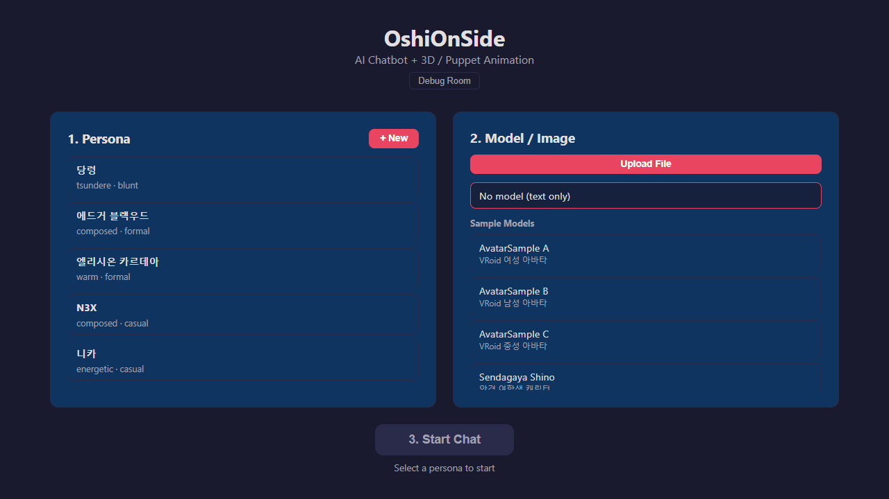
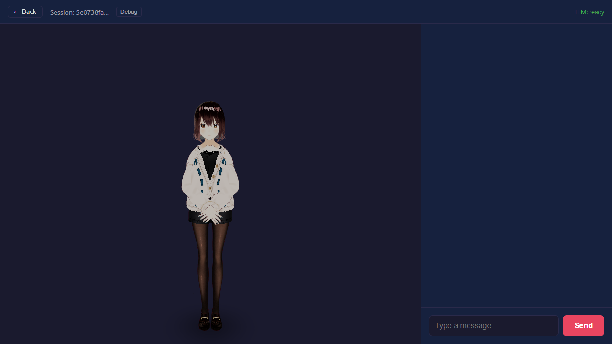

# OshiOnSide

AI 챗봇 + 3D 모델 애니메이션. 캐릭터 페르소나를 만들고 3D 모델(VRM / glTF / GLB)을 고르면, AI와 대화하는 동안 모델이 감정 · 행동 모션을 실시간으로 보여준다. **로컬 LLM**으로 동작해서 대화가 PC 밖으로 나가지 않는다.

## 설치 · 실행 (Windows)

1. [Ollama](https://ollama.com/download/windows) 설치 (로컬 LLM 실행기)
2. [Releases](../../releases)에서 `OshiOnSide-<버전>-windows.zip`을 받아 압축 해제
3. `play.bat` 실행 — 처음에는 LLM 모델 `qwen2.5:7b`(약 4.7GB)를 받는다. 브라우저가 열리고, 검은 창을 닫으면 종료

Python 포함, 따로 설치할 것은 Ollama뿐. Ollama가 없으면 `play.bat`이 설치 페이지를 연다. RAM 16GB 이상 권장, GPU가 있으면 Ollama가 자동으로 쓴다.

## 기능

- **페르소나**: 아키타입(밝은 · 쿨한 · 수줍은 · 츤데레 · 다정한)으로 빠르게 만들고 말투 · 성격 · 1인칭 · 말버릇을 세부 설정. 기본 캐릭터 5명 포함
- **3D 모델**: VRM / glTF / GLB 업로드, 복잡도 5단계 자동 분류. 샘플 VRM 모델 내장
- **모션**: 대화에서 감정 · 행동을 뽑아 모션으로 연결. VRM은 VRMA 애니메이션 + 표정, glTF는 절차적 애니메이션
- **채팅**: 토큰 단위 실시간 출력, 대화 기록 자동 저장 · 이어하기

기록 · 업로드한 모델은 압축을 푼 폴더의 `app/data`, `app/uploads`에 저장된다. 다른 모델을 쓰려면 `app/config/default.yaml`의 `llm.model`을 바꾸고 `ollama pull <모델>`.

## 출처

- 샘플 VRM 모델: [madjin/vrm-samples](https://github.com/madjin/vrm-samples) (CC0)
- VRMA 애니메이션: [tk256ailab/vrm-viewer](https://github.com/tk256ailab/vrm-viewer) (MIT)

## 문의

버그 · 제안은 [Issues](../../issues)에.
